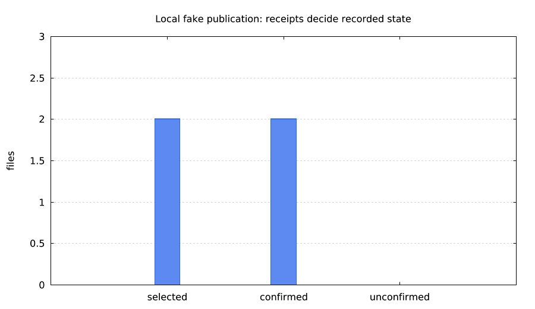
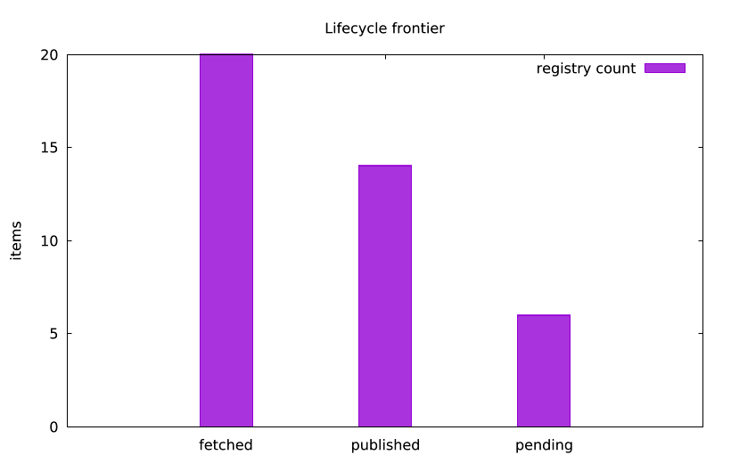
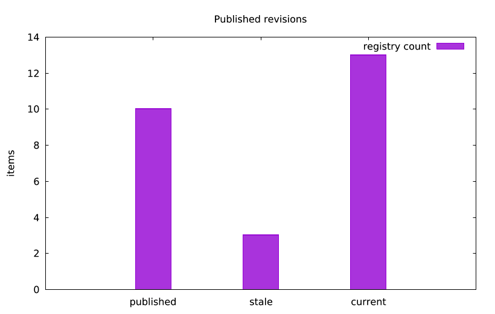
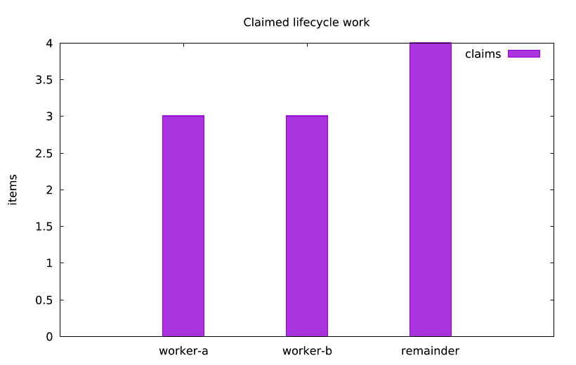
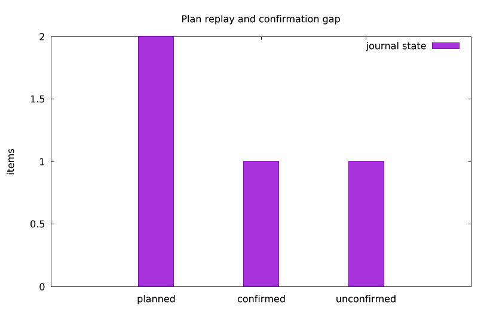
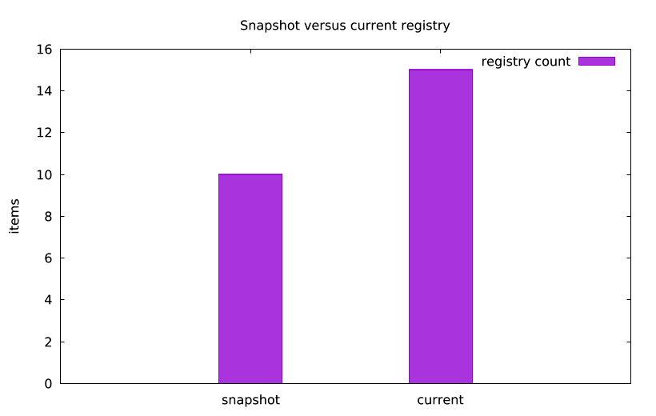
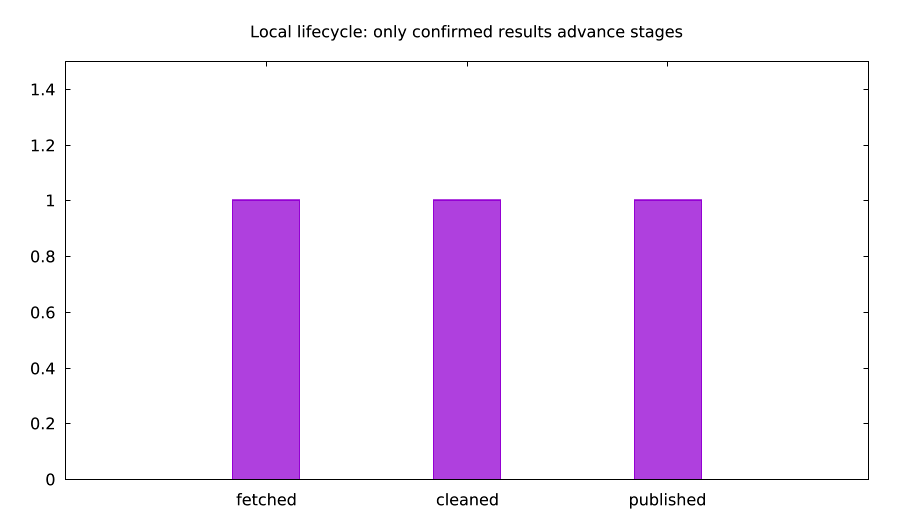

# lmfiles

A local file lifecycle registry. Your LMScript owns the job; existing hosts own transfers.

| Publish only changed files | Find the pending frontier | Detect changed source revisions |
|---|---|---|
|  |  |  |
| Two synthetic texts, local fake objects, confirmed receipts and repeatable no-op. [Example](examples/publish_ttl.lms)<br>`lmctl https://raw.githubusercontent.com/lmctl-ai/lmfiles/main/examples/publish_ttl.lms` | 20 fetched, 14 published, six pending; selection reads the sparse frontier. [Example](examples/frontier.lms)<br>`lmctl https://raw.githubusercontent.com/lmctl-ai/lmfiles/main/examples/frontier.lms` | Three changed sources remain distinct from the previously published revisions. [Example](examples/revisions.lms)<br>`lmctl https://raw.githubusercontent.com/lmctl-ai/lmfiles/main/examples/revisions.lms` |

| Claim independent work | Resume from confirmed results | Read a stable snapshot |
|---|---|---|
|  |  |  |
| Two workers claim three items each, leaving four available. [Example](examples/claims.lms)<br>`lmctl https://raw.githubusercontent.com/lmctl-ai/lmfiles/main/examples/claims.lms` | One confirmed result out of two intents; duplicate replay does not repeat the state change. [Example](examples/journal_resume.lms)<br>`lmctl https://raw.githubusercontent.com/lmctl-ai/lmfiles/main/examples/journal_resume.lms` | A snapshot retains ten items after the current registry grows to fifteen. [Example](examples/snapshots.lms)<br>`lmctl https://raw.githubusercontent.com/lmctl-ai/lmfiles/main/examples/snapshots.lms` |



One script combines real loopback lmcurl with local cleanup and a fake S3-like
executor. Confirmed journal receipts advance each user-defined stage. Rerun after
`fail-fetch`, `fail-clean` or `fail-publish` to recover the confirmation gap.
`lmctl https://raw.githubusercontent.com/lmctl-ai/lmfiles/main/examples/pipeline_lifecycle.lms`

## Build and run

Version **0.1.0 is released**. Current main targets **0.1.1**; this patch is
not tagged or released by its implementer. README URLs install the published
latest version. To exercise0.1.1 before the Lead publishes it, build locally and
put that binary on PATH. lmplot supplies the pictures; publish_ttl additionally
uses explicit lmaws demo mode. All example inputs are synthetic.

Format1 databases from0.1.0 are automatically upgraded with a retained backup.
Read [the upgrade/rollback contract](docs/FORMAT_UPGRADE.md) before opening an
existing DB with0.1.1. There is no reset or silent deletion.

```sh
mvn -q package                         # Java 21+; immutable SDK archive verified
mkdir -p target/bin
cp scripts/lmfiles-managed target/bin/lmfiles
export PATH="$PWD/target/bin:$PATH"
bash test.sh                           # managed gate
bash scripts/build-native.sh           # GraalVM 25 native-image on PATH
bash test.sh --native                   # native gate
export PATH="$PWD/target:$PATH"
lmctl examples/publish_ttl.lms          # one LMScript, several explicit host blocks
lmctl examples/publish_ttl.lms          # zero selected transfers on unchanged rerun
lmctl examples/publish_ttl.lms changed  # one changed revision
```

Linux binaries use dynamic glibc (CI baseline Ubuntu 22.04/glibc 2.35) with other
native-image dependencies static. macOS/Windows have passed the manual-only
[five-platform managed/native CI](https://github.com/lmctl-ai/lmfiles/actions/runs/40526639317). Measurements here are Linux x64. No application JNI,
C++ sidecar, cloud SDK or SSH library is linked into the registry. H2 MVStore uses
positional file I/O, not mmap. Its upstream native metadata that pulls in AWT is
excluded and a minimal explicit reflection configuration is supplied.

## What the registry does

- Records stable items, aliases, observations and **user-named** stage outcomes.
- Keeps latest attempt and last successful revision separate, with append-only events.
- Answers explicit subset questions locally; unobserved, missing and changed are distinct.
- Maintains caller-declared sparse stage-difference indexes transactionally.
- Provides bounded cursors, batches, snapshots, leased/fenced claims and local integrity checks.
- Optionally validates a checksummed plan/result journal and records only reported outcomes.

No fetching, uploading, local-file deletion, stage ordering, retry/retention rule,
remote listing, remote stat, HEAD, credential lookup or scheduling happens in core.
A record is a **belief reported by the caller**, not proof of current remote state.
Outside changes are invisible until the script chooses to verify them. A query
never decides that an old record needs refreshing.

## Scripting API

The context is `registry`; structured inputs/receipts are JSON strings, with opaque
`Registry`, `Snapshot`, `Cursor`, `WriteBatch` and `Rows` handles. Generated exact
signatures: [schema](schema/lmfiles.dsl.json), `lmfiles --dsl-signatures`.
The implemented subset and JSON contracts are in [docs/API.md](docs/API.md).

```text
let db = registry.open("state.mv", "my-job", "{}");
let item = db.item_upsert("{\"id\":\"synthetic-law\"}", "{}");
# item is a receipt JSON string containing item and revision, not a DSL struct.
db.close();
```

`LMFILES_MAX_MEMORY_MB` is a positive whole number of MiB (default 256).
VM allocations and bounded host records/pages/batches enforce this budget;
MVStore cache defaults to 8 MiB, is charged to the VM on each open, and cannot
exceed half the configured budget.
The JVM managed launcher also caps its heap. Native images reserve 4 GiB address
space with a 3 GiB runtime heap ceiling; the gate exercises the host under a
6 GiB virtual-address limit. The budget is an application allocation bound, not
an exact process RSS quota; native runtime/cache overhead is reported separately.

## Durability and limits

One process owns the writer OS lock. Every mutation/batch commits and syncs
before acknowledgment; failed batches roll back together. CRC32C-protected,
compressed binary item/event rows are co-located; stage IDs and alias families are interned. Equal latest/success
summaries share one stored representation.
Snapshots pin MVStore versions; queries stream bounded pages. Claims coordinate
local workers, not remote exactly-once effects. Fixed deadlines survive process reopen; persisted generations fence expired or
replaced owners. A backward wall-clock step fences the prior clock era. See
[lease semantics](docs/LEASES.md).

Plans/results use canonical JSONL, CRC32C, instruction SHA-256, explicit item/stage/
revision bindings, immutable result IDs and a 64 KiB line ceiling. Replay rejects
out-of-plan or conflicting completions before applying changes. Raw non-UTF-8 path
aliases can be represented as tagged Base64 bytes; unsupported local-path I/O is
rejected. A transfer completed before any durable result remains unconfirmed and
may be repeated. See [docs/JOURNAL.md](docs/JOURNAL.md).

The initial codec deliberately favors explicit correctness and compact compressed
payloads over a custom LSM. It does **not** claim the design's unmeasured
750–1,050 bytes/item target or a 100M qualification. Measured workloads and crash
results are recorded in [docs/MEASUREMENTS.md](docs/MEASUREMENTS.md).

## Development

`test.sh` is the gate. CI is **workflow_dispatch only**, has no cloud credentials,
and does not tag/release. `examples/render-all.sh` regenerates the six gallery images.
The original design and review live in the sibling lmaws repo; implementation notes
and 1C scope are in [durable-memory/index.md](durable-memory/index.md).

MIT, Copyright 2026 Lattice Systems LLC. H2 is redistributed under MPL 2.0;
see [THIRD_PARTY_NOTICES](THIRD_PARTY_NOTICES) and embedded `--notices`.
